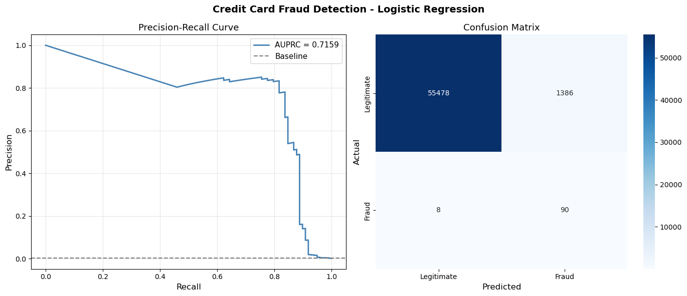

# Pipeline

This notebook queries the `transactions` collection from MongoDB Atlas, trains a logistic regression model to detect credit card fraud, evaluates performance using precision, recall, and average precision (AP), and generates visualizations.


```python
# Imports and logging
import os
import logging
import pandas as pd
import matplotlib.pyplot as plt
import seaborn as sns
from pymongo import MongoClient
from sklearn.linear_model import LogisticRegression
from sklearn.preprocessing import StandardScaler
from sklearn.model_selection import train_test_split
from sklearn.metrics import (
    precision_score, recall_score, f1_score,
    average_precision_score, precision_recall_curve,
    confusion_matrix, classification_report
)

# Configure logging to record all pipeline steps to a log file
logging.basicConfig(
    filename='pipeline.log',
    level=logging.INFO,
    format='%(asctime)s - %(levelname)s - %(message)s'
)

from pathlib import Path

# Run from the repository root or the pipeline directory.
PROJECT_ROOT = Path.cwd().parent if Path.cwd().name == "pipeline" else Path.cwd()
IMAGE_DIR = PROJECT_ROOT / "images"
IMAGE_DIR.mkdir(parents=True, exist_ok=True)
```


```python
# Connect using a MongoDB URI supplied through the environment
try:
    uri = os.environ.get("MONGODB_URI")
    if not uri:
        raise ValueError("Set MONGODB_URI before running this notebook.")
    client = MongoClient(uri, serverSelectionTimeoutMS=10000)
    client.admin.command("ping")
    logging.info("Connected to MongoDB successfully")
    print("Connected successfully")
except Exception:
    logging.error("Could not connect to MongoDB; check your configuration.")
    raise

db = client[os.environ.get("MONGODB_DATABASE", "ds4320_project2")]
collection = db["transactions"]
```

    Connected successfully


```python
# Query all documents from transactions collection into a dataframe
try:
    cursor = collection.find({}, {"_id": 0})
    df = pd.DataFrame(list(cursor))
    logging.info(f"Loaded {len(df)} documents from transactions collection")
    print(f"Loaded {len(df)} rows")
    print(df.head())
except Exception as e:
    logging.error(f"Failed to load data: {e}")
    raise
```

    Loaded 284807 rows
       Time        V1        V2        V3        V4        V5        V6        V7  \
    0   0.0 -1.359807 -0.072781  2.536347  1.378155 -0.338321  0.462388  0.239599   
    1   0.0  1.191857  0.266151  0.166480  0.448154  0.060018 -0.082361 -0.078803   
    2   1.0 -1.358354 -1.340163  1.773209  0.379780 -0.503198  1.800499  0.791461   
    3   1.0 -0.966272 -0.185226  1.792993 -0.863291 -0.010309  1.247203  0.237609   
    4   2.0 -1.158233  0.877737  1.548718  0.403034 -0.407193  0.095921  0.592941   
    
             V8        V9  ...       V21       V22       V23       V24       V25  \
    0  0.098698  0.363787  ... -0.018307  0.277838 -0.110474  0.066928  0.128539   
    1  0.085102 -0.255425  ... -0.225775 -0.638672  0.101288 -0.339846  0.167170   
    2  0.247676 -1.514654  ...  0.247998  0.771679  0.909412 -0.689281 -0.327642   
    3  0.377436 -1.387024  ... -0.108300  0.005274 -0.190321 -1.175575  0.647376   
    4 -0.270533  0.817739  ... -0.009431  0.798278 -0.137458  0.141267 -0.206010   
    
            V26       V27       V28  Amount  Class  
    0 -0.189115  0.133558 -0.021053  149.62      0  
    1  0.125895 -0.008983  0.014724    2.69      0  
    2 -0.139097 -0.055353 -0.059752  378.66      0  
    3 -0.221929  0.062723  0.061458  123.50      0  
    4  0.502292  0.219422  0.215153   69.99      0  
    
    [5 rows x 31 columns]


```python
# Separate features and target, then split into train and test sets
try:
    X = df.drop(columns=["Class"])
    y = df["Class"]
    X_train, X_test, y_train, y_test = train_test_split(
        X, y, test_size=0.2, random_state=42, stratify=y
    )
    logging.info(f"Train size: {len(X_train)}, Test size: {len(X_test)}")
    print(f"Train size: {len(X_train)}, Test size: {len(X_test)}")
except Exception as e:
    logging.error(f"Failed to prepare data: {e}")
    raise
```

    Train size: 227845, Test size: 56962


## Data Preparation

The data is queried directly from MongoDB into a pandas dataframe. The `Class` column is separated as the target variable and the remaining 30 columns are used as features. The dataset is split 80/20 into training and test sets using stratified sampling to preserve the fraud ratio in both splits.


```python
# Train logistic regression with class_weight='balanced' to handle class imbalance
# Scale Amount and Time before training since they are on different scales than PCA components
try:
    scaler = StandardScaler()
    X_train_scaled = X_train.copy()
    X_test_scaled = X_test.copy()
    X_train_scaled[["Amount", "Time"]] = scaler.fit_transform(X_train[["Amount", "Time"]])
    X_test_scaled[["Amount", "Time"]] = scaler.transform(X_test[["Amount", "Time"]])
    
    model = LogisticRegression(class_weight="balanced", max_iter=2000, random_state=42)
    model.fit(X_train_scaled, y_train)
    logging.info("Logistic regression model trained successfully")
    print("Model trained successfully")
except Exception as e:
    logging.error(f"Failed to train model: {e}")
    raise
```

    Model trained successfully


## Analysis Rationale

Logistic regression was chosen for this binary classification problem. Amount and Time are scaled using parameters fitted on the training data only. Class weighting gives the rare fraud class more influence during training without generating synthetic transactions.

Accuracy alone can be misleading: predicting every transaction as legitimate would achieve about 99.8% accuracy while detecting no fraud. This model is evaluated using precision, recall, F1, and average precision (AP).

At the default classification threshold, the saved results show 91.8% recall and 6.1% precision: 90 of 98 fraud cases were detected, while 1,386 legitimate transactions were flagged. This demonstrates a substantial false-positive burden. Whether that tradeoff is acceptable depends on fraud costs and review capacity, which this project does not evaluate.

The anonymized PCA features limit interpretation in business terms. These results come from a random split of a two-day historical dataset and do not establish performance on future transactions.


```python
# Evaluate model using precision, recall, F1, and AP
try:
    y_pred = model.predict(X_test_scaled)
    y_prob = model.predict_proba(X_test_scaled)[:, 1]
    precision = precision_score(y_test, y_pred)
    recall = recall_score(y_test, y_pred)
    f1 = f1_score(y_test, y_pred)
    average_precision = average_precision_score(y_test, y_prob)
    logging.info(f"Precision: {precision:.4f}, Recall: {recall:.4f}, F1: {f1:.4f}, AP: {average_precision:.4f}")
    print(f"Precision: {precision:.4f}")
    print(f"Recall:    {recall:.4f}")
    print(f"F1 Score:  {f1:.4f}")
    print(f"AP:     {average_precision:.4f}")
    print("\nClassification Report:")
    print(classification_report(y_test, y_pred, target_names=["Legitimate", "Fraud"]))
except Exception as e:
    logging.error(f"Failed to evaluate model: {e}")
    raise
```

    Precision: 0.0610
    Recall:    0.9184
    F1 Score:  0.1144
    AP:     0.7159
    
    Classification Report:
                  precision    recall  f1-score   support
    
      Legitimate       1.00      0.98      0.99     56864
           Fraud       0.06      0.92      0.11        98
    
        accuracy                           0.98     56962
       macro avg       0.53      0.95      0.55     56962
    weighted avg       1.00      0.98      0.99     56962
    


```python
# Generate publication-quality precision-recall curve and confusion matrix
try:
    fig, axes = plt.subplots(1, 2, figsize=(14, 6))
    fig.suptitle("Credit Card Fraud Detection - Logistic Regression", fontsize=14, fontweight="bold")

    # Precision-Recall Curve
    precision_vals, recall_vals, _ = precision_recall_curve(y_test, y_prob)
    axes[0].plot(recall_vals, precision_vals, color="steelblue", lw=2, label=f"AP = {average_precision:.4f}")
    axes[0].axhline(y=y_test.mean(), color="gray", linestyle="--", label="Baseline")
    axes[0].set_xlabel("Recall", fontsize=12)
    axes[0].set_ylabel("Precision", fontsize=12)
    axes[0].set_title("Precision-Recall Curve", fontsize=13)
    axes[0].legend(fontsize=11)
    axes[0].grid(True, alpha=0.3)

    # Confusion Matrix
    cm = confusion_matrix(y_test, y_pred)
    sns.heatmap(cm, annot=True, fmt="d", cmap="Blues", ax=axes[1],
                xticklabels=["Legitimate", "Fraud"],
                yticklabels=["Legitimate", "Fraud"])
    axes[1].set_xlabel("Predicted", fontsize=12)
    axes[1].set_ylabel("Actual", fontsize=12)
    axes[1].set_title("Confusion Matrix", fontsize=13)

    plt.tight_layout()
    plt.savefig(IMAGE_DIR / "fraud_detection_results.png", dpi=300, bbox_inches="tight")
    plt.show()
    logging.info("Visualizations saved to ../images/fraud_detection_results.png")
    print("Visualizations saved")
except Exception as e:
    logging.error(f"Failed to generate visualizations: {e}")
    raise
```


    

    


    Visualizations saved


## Visualization Rationale

The precision-recall curve shows performance across thresholds, while the confusion matrix shows results at the default threshold. Average precision is 0.7159, compared with a positive-class prevalence of approximately 0.0017. The model detects 90 of 98 fraud cases and flags 1,386 legitimate transactions.

The saved chart labels average precision as AUPRC. The reported value was calculated using scikit-learn's average_precision_score, rather than trapezoidal integration of the curve.
