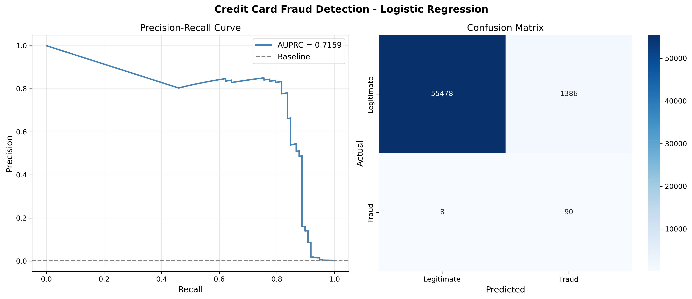

# Can Your Bank Tell When You're Being Robbed?

## The Stakes Are Higher Than You Think
Credit card fraud costs the global financial system tens of billions of dollars every year, and the burden falls on both banks and the customers they serve. Every fraudulent transaction that slips through undetected is money lost, and every legitimate transaction wrongly flagged is a frustrated customer. Getting this right matters.

## The Problem
Financial institutions process millions of credit card transactions every day and need to evaluate each one in real time. The challenge is that fraudulent transactions are extremely rare in this dataset, making up less than 0.2% of its transactions, which means most models will miss them entirely if not designed carefully. Standard accuracy metrics are misleading in this context because a model that labels every transaction as legitimate would still be over 99% accurate while catching zero fraud cases.

## The Solution
This project builds a logistic regression model trained on 227,845 transactions from a dataset of 284,807 anonymized credit card transactions from European cardholders to predict whether a given transaction is fraudulent. The model is evaluated using precision and recall rather than accuracy, and class imbalance is addressed during training to give the rare fraud class more influence during training. The result is a pipeline that demonstrates how transaction-level fraud detection can work on real-world data.

## Results

On the held-out test set, the model detects 90 of 98 fraud cases, or 91.8%, while incorrectly flagging 1,386 legitimate transactions. Only 6.1% of flagged transactions are actually fraudulent. This highlights why recall must be considered alongside precision and the cost of false alarms.

The project does not establish that this operating threshold is suitable for a bank. That would require cost information and further evaluation on newer data.

## Chart

The chart's AUPRC label refers to average precision (0.7159), as computed in the notebook.
